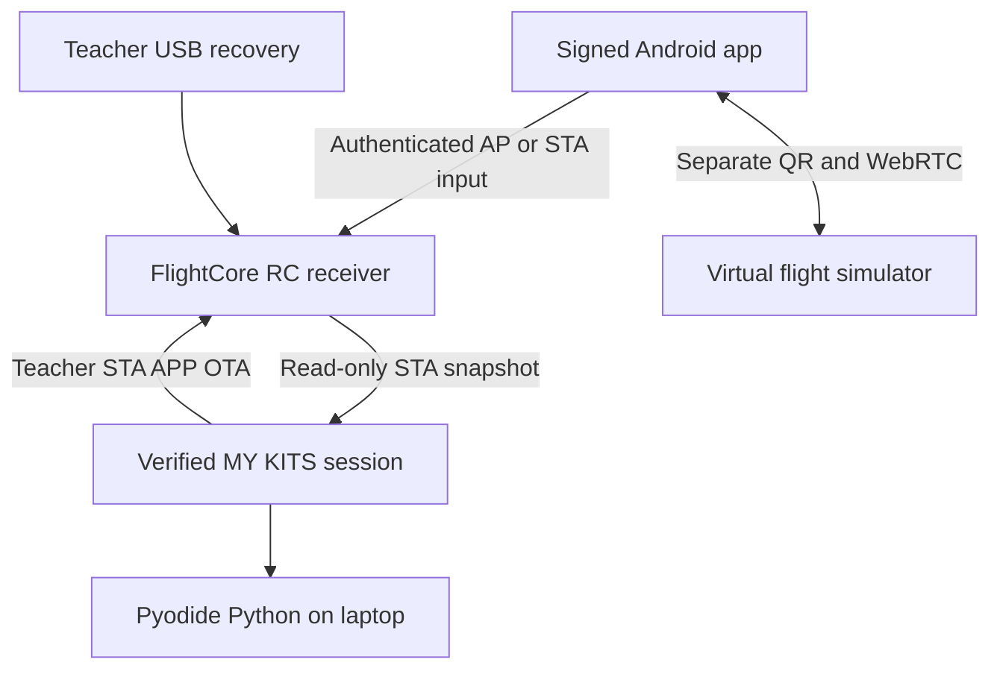

# DroneLab 1.7 network architecture

## Data paths

A1 (ESP32-C3 Super Mini) and A2 (XIAO ESP32-C6) use one Wi-Fi radio. Normal `auto` mode attempts saved STA credentials while keeping AP available. AP follows the STA router channel; a router/channel change can interrupt the phone. Reconnection restores monitoring, never an RC lease or virtual ARM. Physical motors remain disabled.

## Factory-to-student setup

1. Factory flashes the matching 1.4.0 FACTORY image at offset 0 using USB. Existing kits need the matching APP upgrade and label installation; old firmware cannot acquire this feature from a WebApp update alone.
2. Factory enrolls a teacher USB passphrase and runs `python3 tools/provision_kit_label.py --help` for private-label provisioning. The utility generates 256 random bits, writes its private output with mode 0600 and refuses to overwrite it, then uses protected USB admin to install the secret. Keep the label off public photos and never commit its file. A six-digit Kit Code is only a selector.
3. Student opens the official HTTPS WebApp while Internet is available, keeps that tab open, and selects **New Kit / First-Time Setup**. Use supported Chromium Local Network Access, with permission allowed. Use OS Wi-Fi settings to join the kit AP; JavaScript cannot switch SSIDs.
4. Enter the private label only in the official HTTPS WebApp or signed Android app. Full Device ID and a cryptographic device proof must both match. The local HTTP help portal deliberately has no secret/password fields: a page served over unauthenticated HTTP cannot securely deliver credential-entry JavaScript against an active LAN attacker.
5. AP setup authority lasts 5 minutes. Scan a 2.4 GHz router, select it, and Test & Save. Only new association + DHCP to that SSID and successful atomic NVS readback produce `saved`. HTTP 202 means pending. On failure, previous saved credentials survive.
6. Switch the laptop to the router and select **Connect STA / Resume**. Probe the returned STA IP and known mDNS name; match the full immutable Device ID before binding. mDNS/DHCP/router isolation can require entering the IP manually.
7. Android can stay on AP or join the same STA router. Select the matching Android AP/STA connection, verify the immutable Device ID and actual request transport, enter the private label in the signed app and explicitly enable diagnostic input. Laptop Python reads `/api/rc/snapshot` through its independently authenticated STA session. No USB or WebRTC relay is required for this path.

## Trust, persistence and recovery

The label authorizes temporary setup and derives a separate 128-bit diagnostic credential. Only the diagnostic credential may be remembered by the existing opt-in encrypted browser vault; the label itself is cleared from the field and never saved. Session storage supports refresh; a new laptop uses its label. An untrusted/shared browser should use session-only access and Forget Pairing afterward. Browser encryption does not protect a compromised browser profile or malicious same-origin script.

Challenges live 30 seconds; setup scope 5 minutes; diagnostic sessions 30 minutes. Sessions are bound to Device ID, boot nonce, client ID, a session key and monotonically increasing request counters. POST bodies use AES-GCM; requests and responses have HMAC-SHA256 proofs. Reboot invalidates all sessions. Protected USB label rotation/revocation invalidates derived credentials; factory reset clears provisioning. NVS is not protected against physical flash extraction without Secure Boot/Flash Encryption; enabling those is a separate manufacturing decision.

The AP Wi-Fi password and Kit Code grant no API authority. Teachers retain the legacy per-device admin key for STA APP OTA; student labels cannot update firmware. This legacy bearer path requires a trusted management LAN (or use USB recovery). Never send admin keys through public URLs. Network factory flashing is unsupported.

RC has one controller, a 350 ms input deadman and 1800 ms ownership lease. Accepted frames renew both. Expiry neutralizes throttle to 1000 and axes to 1500. Authentication reconnect does not reacquire control. Wi-Fi setup/scan/mode changes and OTA are blocked during ownership. STOP releases input; no operation enables physical motors.

## Observable network state

`networkState` reports AP_ONBOARDING, STA_CONNECTING, STA_TESTING, STA_CONNECTED, AP_STA_COEXISTENCE, AP_JOYSTICK_READY or NETWORK_RECOVERY. `phase`, `wifiTestState`, configured `mode`, actual `requestTransport`, AP/STA active flags, channel, IPs, RSSI, disconnect reason and bootId describe transitions. `wifiTestState=saved` plus matching ID is the handover prerequisite. USB recovery remains a separate physical path. Reason 36 is STA_LEAVING, not a password verdict.

## Compatibility boundaries

HTTPS-to-private-HTTP requests depend on browser Local Network Access support and permission; CORS alone cannot grant this. Ordinary Firefox/Safari support is not claimed. Offline WebApp caching must finish while online, and real permission/offline transitions remain hardware/browser acceptance items. The device help page works without Internet; a signed Android app is an alternative commissioning client.

QR/WebRTC stays separate: QR exchange can operate without Internet only if the peer route is reachable; six-digit CONNECT signaling requires Internet. AP-phone versus router-laptop cross-subnet WebRTC is not assumed. Public signaling never carries direct AP joystick frames.

Primary references: [Chrome Local Network Access](https://developer.chrome.com/blog/local-network-access), [MDN Local Network Access](https://developer.mozilla.org/en-US/docs/Web/Privacy/Guides/Local_network_access), [Espressif ESP32-C3 Wi-Fi](https://docs.espressif.com/projects/esp-idf/en/v5.5.4/esp32c3/api-guides/wifi.html).
